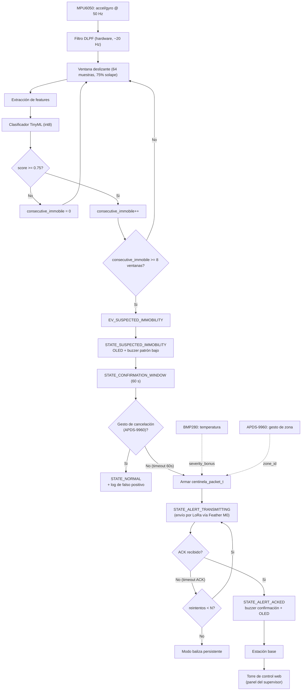
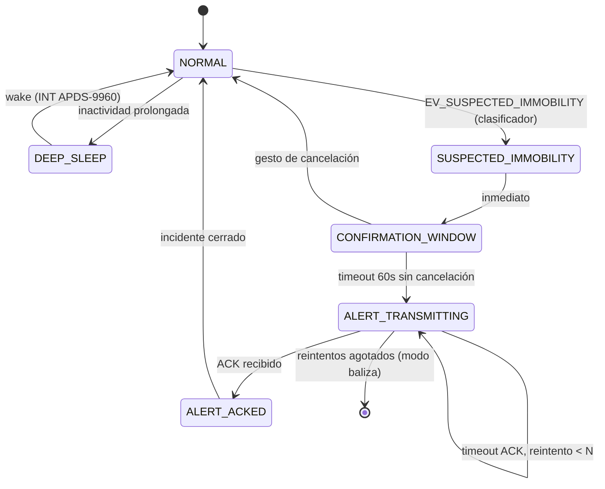

# CENTINELA — Arquitectura de Firmware y Procesamiento de Datos

**Versión:** borrador v0.1
**Base:** esquemático KiCad (ESP32-S2-WROVER + MPU6050 + BMP280 + APDS-9960 + OLED + buzzer + Adafruit Feather M0 RFM9x)

Este documento define, a nivel de código, cómo el firmware de la pulsera CENTINELA adquiere datos de cada sensor, cómo se procesan, qué valores finales produce y cómo esos valores se usan para decidir y transmitir una alerta.

---

## 1. Resumen del sistema

CENTINELA es una pulsera IoT/Edge AI que detecta inmovilidad anómala sostenida en trabajadores agrícolas aislados. El ESP32-S2 corre un clasificador TinyML sobre datos inerciales del MPU6050. Si detecta una posible caída/incapacitación, abre una ventana de confirmación de 60 s en la que el trabajador puede cancelar con un gesto (APDS-9960). Si no cancela, se transmite una alerta por LoRa a una estación base y se visualiza en una torre de control web.

### 1.1 Diagrama de flujo general

Vista de extremo a extremo: desde la muestra cruda del IMU hasta que la alerta aparece en la torre de control. Detalle de cada bloque en las secciones 4 a 7.



---

## 2. Mapa de hardware y buses

Según el esquemático:

| Componente | Ref. | Interfaz | Notas |
|---|---|---|---|
| MPU6050 (IMU) | U1 | I2C compartido (SDAD/SCLD) | VLOGIC/VDD a 3.3V, AD0 a GND → dirección 0x68 |
| BMP280 (temp/presión) | U2 | I2C compartido (SDAD/SCLD) | Sustituye al BMP180 mencionado en la propuesta original |
| APDS-9960 (gestos/proximidad/luz) | U3 | I2C compartido (SDAD/SCLD) + línea INT dedicada | INT usado como interrupción de gesto/wake |
| OLED 0.91" | U5 | I2C compartido (SDAD/SCLD) | Solo display, sin touch |
| Buzzer | BZ1 | GPIO digital directo | Control por PWM/tono |
| Adafruit Feather M0 RFM9x (LoRa) | A1 | SPI (SCK/MOSI/MISO) + UART (RX/TX) + I2C + EN/RESET | Actúa como **co-procesador de radio**, no como módulo RFM9x desnudo |

**Nota importante sobre el bloque LoRa:** el esquemático conecta al Feather M0 casi todos sus buses (SPI, UART, I2C, EN/RESET). Esto implica una decisión de arquitectura que conviene fijar por escrito antes de programar:

- **Opción A — SPI directo:** el ESP32-S2 es maestro SPI y el Feather M0 corre un firmware "esclavo" que traduce comandos SPI a operaciones del RFM9x (RadioHead/LoRa.h). Más rápido, pero requiere firmware custom en el SAMD21 del Feather.
- **Opción B — UART tipo módem:** el Feather M0 corre un firmware con protocolo de comandos simple sobre RX/TX (similar a comandos AT), y el ESP32 solo envía/recibe tramas de texto o binarias por serial. Más simple de depurar, menor throughput.

Se recomienda **Opción B (UART)** para el prototipo por velocidad de desarrollo, dejando SPI como mejora futura si se necesita menor latencia. *(Pendiente de confirmar según lo que ya se implementó en el Feather.)*

Todos los sensores I2C comparten bus, por lo que el firmware debe direccionarlos individualmente (direcciones por defecto: MPU6050 `0x68`, BMP280 `0x76/0x77`, APDS-9960 `0x39`, OLED SSD1306-like `0x3C`).

---

## 3. Arquitectura de firmware (FreeRTOS, dual-core)

El ESP32-S2 corre FreeRTOS con tareas repartidas así:

```
Core 0 (protocol/sensor core)          Core 1 (application core)
├── Task_SensorAcquisition (50 Hz)     ├── Task_Inference (TinyML)
├── Task_EnvSample (1 Hz, BMP280)      ├── Task_StateMachine
├── Task_GestureISR (event-driven)     ├── Task_LoRaComm
└── Task_PowerMgmt                     └── Task_UI (OLED + buzzer)
```

Comunicación entre tareas vía colas (`QueueHandle_t`) y un buffer circular protegido por mutex para las muestras del IMU.

```c
// Buffer de ventana deslizante para el clasificador
#define WINDOW_SIZE   64      // muestras (a 50 Hz ≈ 1.28 s de ventana)
#define WINDOW_STRIDE 16      // solape del 75%

typedef struct {
  int16_t ax, ay, az;   // acelerómetro crudo (LSB)
  int16_t gx, gy, gz;   // giroscopio crudo (LSB)
  uint32_t t_ms;
} imu_sample_t;

static imu_sample_t imu_window[WINDOW_SIZE];
static SemaphoreHandle_t imu_mutex;
static QueueHandle_t q_inference_result;
static QueueHandle_t q_state_events;
```

---

## 4. Adquisición de datos por dispositivo

### 4.1 MPU6050 — sensor primario del clasificador

- **Datos crudos:** aceleración (ax, ay, az) y velocidad angular (gx, gy, gz), 16 bits cada eje.
- **Frecuencia:** 50 Hz vía FIFO interno del MPU6050 (reduce carga de I2C frente a polling por registro).
- **Escalas configuradas:** ±4g (acelerómetro), ±500°/s (giroscopio) — suficiente para capturar caída sin saturar en golpe.
- **Preprocesamiento:**
  1. Conversión LSB → unidades físicas (g, °/s). El MPU6050 no entrega directamente "g" ni "°/s", entrega enteros crudos de 16 bits que hay que dividir por un factor de sensibilidad. Ese factor está definido en el datasheet del fabricante (InvenSense, *MPU-6050 Register Map and Descriptions*, tabla de sensibilidad del acelerómetro/giroscopio) y depende del rango full-scale configurado:

     | Sensor | Rango configurado | Sensibilidad (datasheet) | Fórmula |
     |---|---|---|---|
     | Acelerómetro | ±4g (`ACCEL_RANGE_4G`) | 8192 LSB/g | `accel_g = raw / 8192.0` |
     | Giroscopio | ±500°/s (`GYRO_RANGE_500DPS`) | 65.5 LSB/(°/s) | `gyro_dps = raw / 65.5` |

     Si más adelante se cambia el rango en `mpu6050_init()` (ej. a ±2g u ±8g), hay que usar la sensibilidad correspondiente a ese rango — no es la misma constante para todos los rangos.
  2. Filtro pasa-bajas (DLPF interno del MPU6050, ~20 Hz) para quitar vibración de alta frecuencia.
  3. Cálculo de magnitud de aceleración: `|a| = sqrt(ax² + ay² + az²)`.
  4. Ventaneo (64 muestras, solape 75%) y extracción de features antes de pasar al modelo (sección 5).

```c
void task_sensor_acquisition(void *arg) {
  mpu6050_init(ACCEL_RANGE_4G, GYRO_RANGE_500DPS, DLPF_20HZ);
  while (1) {
    imu_sample_t s;
    mpu6050_read_fifo(&s.ax, &s.ay, &s.az, &s.gx, &s.gy, &s.gz);
    s.t_ms = millis();
    xSemaphoreTake(imu_mutex, portMAX_DELAY);
    imu_window_push(&s);
    xSemaphoreGive(imu_mutex);
    vTaskDelay(pdMS_TO_TICKS(20)); // 50 Hz
  }
}
```

### 4.2 BMP280 — variable de contexto ambiental

- **Datos crudos:** temperatura (°C) y presión (hPa, opcional).
- **Frecuencia:** 1 muestra/60 s (forced mode, bajo consumo) — no es señal de decisión, solo contexto.
- **Uso:** modula la **prioridad de la alerta** (ej. temperatura ambiente >35°C sube el nivel de severidad, porque un trabajador inmóvil bajo sol directo tiene mayor riesgo de golpe de calor mientras espera rescate).

```c
float temp_c = bmp280_read_temperature();  // forced mode
uint8_t severity_bonus = (temp_c > 35.0f) ? 1 : 0;
```

### 4.3 APDS-9960 — interacción por gestos (triple función)

- **Datos crudos:** eventos de gesto (UP/DOWN/LEFT/RIGHT), proximidad (0–255), y luz ambiental/color (opcional, no usado en MVP).
- **Modo de lectura:** **event-driven**, no polling — el pin `INT` del APDS-9960 dispara una ISR en el ESP32 solo cuando hay proximidad/gesto detectado. Esto es clave para bajo consumo.
- **Tres funciones del mismo sensor:**
  1. **Wake-up por hardware:** en deep sleep, el `INT` del APDS-9960 es la fuente de interrupción externa (`esp_sleep_enable_ext0_wakeup`) que saca al ESP32 del sueño profundo.
  2. **Declaración de zona (check-in):** el trabajador hace un gesto específico (ej. swipe derecha) al iniciar labor en una zona de la finca; el firmware mapea el gesto a un `zone_id` (1–4) que se adjunta a cada paquete LoRa, ya que no hay GPS.
  3. **Cancelación de alarma:** durante la ventana de confirmación de 60 s, un gesto (ej. swipe izquierda) cancela la alerta antes de transmitir.

```c
void IRAM_ATTR apds_isr_handler(void *arg) {
  BaseType_t hp_woken = pdFALSE;
  gesture_event_t evt = GESTURE_PENDING;
  xQueueSendFromISR(q_gesture_events, &evt, &hp_woken);
  if (hp_woken) portYIELD_FROM_ISR();
}
```

### 4.4 OLED — diagnóstico local

- **Qué muestra:** estado del sistema (`NORMAL` / `SOSPECHA` / `CONFIRMANDO (Ns restantes)` / `ALERTA ENVIADA`), nivel de batería, zona activa, indicador de enlace LoRa (última confirmación recibida).
- **Frecuencia de refresco:** 1 Hz o solo en cambio de estado (para ahorrar energía; el OLED se apaga en deep sleep).

### 4.5 Buzzer — retroalimentación audible

- **Patrones de tono escalonados según severidad:**

| Estado | Patrón |
|---|---|
| Entrando a ventana de confirmación | 1 beep corto cada 5 s |
| Últimos 10 s de la ventana | beep continuo intermitente rápido |
| Alerta transmitida (sin ACK) | tono grave sostenido |
| Alerta confirmada por estación base (ACK) | 2 beeps agudos |

```c
void buzzer_pattern(alert_severity_t sev) {
  switch (sev) {
    case SEV_LOW:    tone(BUZZER_PIN, 1000, 150); break;
    case SEV_MEDIUM:  tone(BUZZER_PIN, 2000, 300); break;
    case SEV_HIGH:   tone(BUZZER_PIN, 3000, 600); break;
  }
}
```

### 4.6 Módulo LoRa (Feather M0 RFM9x) — comunicación

- **Rol:** co-procesador de radio, ver sección 2. Recibe del ESP32 una trama ya construida y la transmite; retorna ACK/estado del enlace.
- **Topología:** estrella — la pulsera solo habla con la estación base; la estación base retransmite a la torre de control web.
- **Bidireccional:** la torre de control puede empujar mensajes hacia la pulsera (ej. "alerta reconocida por supervisor", "falso positivo confirmado por central").

---

## 5. Pipeline de procesamiento de señales

```
IMU raw (50 Hz)
   → filtro DLPF (hardware)
   → ventana deslizante (64 muestras / 75% solape)
   → extracción de features
   → clasificador TinyML (int8)
   → immobility_score (0.0–1.0)
   → lógica de umbral + duración sostenida
   → evento de estado (STATE_SUSPECTED_IMMOBILITY)
```

**Features extraídas por ventana** (antes de la red, o como capa de entrada según el diseño del modelo):

- Media y desviación estándar de `|a|` (magnitud de aceleración).
- Energía de la señal (suma de cuadrados) en cada eje.
- Cruces por cero de la derivada (proxy de actividad/temblor).
- Magnitud media del giroscopio.

**Criterio de inmovilidad sostenida** (no solo un frame): el modelo puede clasificar una ventana individual como "inmóvil", pero solo se dispara sospecha si **N ventanas consecutivas** (ej. 8 ventanas ≈ ~10 s reales considerando el solape) superan el umbral. Esto evita falsos positivos por micro-pausas normales.

```c
#define IMMOBILITY_THRESHOLD   0.75f
#define CONSECUTIVE_WINDOWS_REQ 8

static uint8_t consecutive_immobile = 0;

void task_inference(void *arg) {
  while (1) {
    float features[N_FEATURES];
    extract_features(imu_window, features);
    float score = tflite_infer(features);   // TinyML int8

    if (score >= IMMOBILITY_THRESHOLD) {
      consecutive_immobile++;
    } else {
      consecutive_immobile = 0;
    }

    if (consecutive_immobile >= CONSECUTIVE_WINDOWS_REQ) {
      state_event_t ev = EV_SUSPECTED_IMMOBILITY;
      xQueueSend(q_state_events, &ev, 0);
      consecutive_immobile = 0; // evita re-disparo mientras ya está en ventana de confirmación
    }
    vTaskDelay(pdMS_TO_TICKS(WINDOW_STRIDE * 20)); // ritmo de nuevas ventanas
  }
}
```

---

## 6. Máquina de estados

```c
typedef enum {
  STATE_NORMAL,
  STATE_SUSPECTED_IMMOBILITY,
  STATE_CONFIRMATION_WINDOW,   // 60 s, cancelable por gesto
  STATE_ALERT_TRANSMITTING,
  STATE_ALERT_ACKED,
  STATE_DEEP_SLEEP
} centinela_state_t;
```

| Transición | Disparador | Acción |
|---|---|---|
| NORMAL → SUSPECTED_IMMOBILITY | `EV_SUSPECTED_IMMOBILITY` del clasificador | Enciende OLED, inicia buzzer patrón bajo |
| SUSPECTED_IMMOBILITY → CONFIRMATION_WINDOW | inmediato | Timer de 60 s, escucha `q_gesture_events` |
| CONFIRMATION_WINDOW → NORMAL | gesto de cancelación detectado | Log local del falso positivo (para reentrenar el modelo después) |
| CONFIRMATION_WINDOW → ALERT_TRANSMITTING | timeout de 60 s sin cancelación | Arma paquete LoRa (sección 7) y transmite |
| ALERT_TRANSMITTING → ALERT_ACKED | ACK recibido de estación base | Buzzer confirmación, OLED "Ayuda en camino" |
| ALERT_TRANSMITTING → ALERT_TRANSMITTING (reintento) | timeout de ACK (ej. 5 s) | Reintenta hasta N veces, luego pasa a modo persistente de baliza |
| cualquier estado activo → DEEP_SLEEP | inactividad prolongada en NORMAL | Apaga periféricos, deja solo INT del APDS-9960 como wake source |

### 6.1 Diagrama de estados (Mermaid)



---

## 7. Protocolo LoRa — estructura de paquete y valores finales

Este es el **valor final** que produce todo el pipeline: un paquete compacto que la estación base reenvía a la torre de control web.

```c
typedef struct __attribute__((packed)) {
  uint8_t  device_id;        // ID único de la pulsera
  uint8_t  packet_type;      // 0=heartbeat, 1=alerta, 2=cancelación_log, 3=ack_confirm
  uint8_t  alert_severity;   // 0=info,1=bajo,2=medio,3=alto (modulado por temperatura)
  float    immobility_score; // último score del clasificador (0.0-1.0), trazabilidad
  float    temperature_c;    // contexto ambiental (BMP280)
  uint8_t  zone_id;          // zona declarada por gesto (1-4), sustituto de GPS
  uint16_t battery_mv;       // estado de batería 18650
  uint32_t timestamp_ms;     // uptime del dispositivo (o RTC si se agrega)
  uint8_t  checksum;         // XOR o CRC8 de los campos anteriores
} centinela_packet_t;        // 20 bytes — cabe cómodo en un payload LoRa
```

- **Heartbeat:** cada N minutos en estado NORMAL, para que la torre de control sepa que la pulsera sigue viva (packet_type=0). Frecuencia a definir según presupuesto de energía (ej. cada 10 min).
- **Alerta:** packet_type=1, con severidad calculada como `base_severity(immobility_score) + severity_bonus(temp_c)`.
- **Log de cancelación:** packet_type=2, opcional/diferido — puede acumularse localmente y enviarse en el próximo heartbeat en vez de gastar batería en una transmisión inmediata, ya que no es una emergencia.

**En la torre de control (lado servidor/web):** cada paquete recibido se decodifica y se persiste con al menos estos campos: `device_id`, `zone_id`, `alert_severity`, `immobility_score`, `temperature_c`, `battery_mv`, `received_at` (timestamp del servidor, no del dispositivo, para evitar depender de reloj no sincronizado del ESP32). Este es el registro que finalmente ve el supervisor en el panel web y sobre el cual se dispara la notificación humana.

---

## 8. Gestión de energía

- **Deep sleep** en estado NORMAL tras un periodo de inactividad sostenida detectada por el propio IMU (baja varianza) — reduce muestreo o entra a sleep con wake por `INT` del APDS-9960 (hardware interrupt, sin polling).
- El módulo LoRa (Feather M0) puede tener su propio sleep coordinado por el pin `EN/RESET` visible en el esquemático, apagándose entre heartbeats.
- Batería 18650 con regulación lineal (AMS1117) — implica que la lectura de `battery_mv` debe hacerse antes del regulador o vía un divisor resistivo dedicado a un ADC del ESP32 (pendiente de confirmar si el esquemático ya contempla ese divisor; no se ve en la vista actual).

---

## 9. Pendientes a definir antes de codificar

1. Confirmar protocolo real ESP32 ↔ Feather M0 (SPI directo vs UART, sección 2).
2. Confirmar si existe divisor resistivo para medir voltaje de batería por ADC.
3. Definir dataset y arquitectura exacta del modelo TinyML (tamaño de la red, framework de entrenamiento — TensorFlow Lite Micro presumido).
4. Definir número de reintentos y timeout de ACK en el protocolo LoRa.
5. Definir si el log de cancelaciones (falsos positivos) se usa para reentrenamiento offline del modelo.

---

*Este documento es la base para dividir el trabajo en módulos de firmware (adquisición, inferencia, máquina de estados, comunicación, energía) y puede versionarse a medida que se confirmen los pendientes de la sección 9.*
